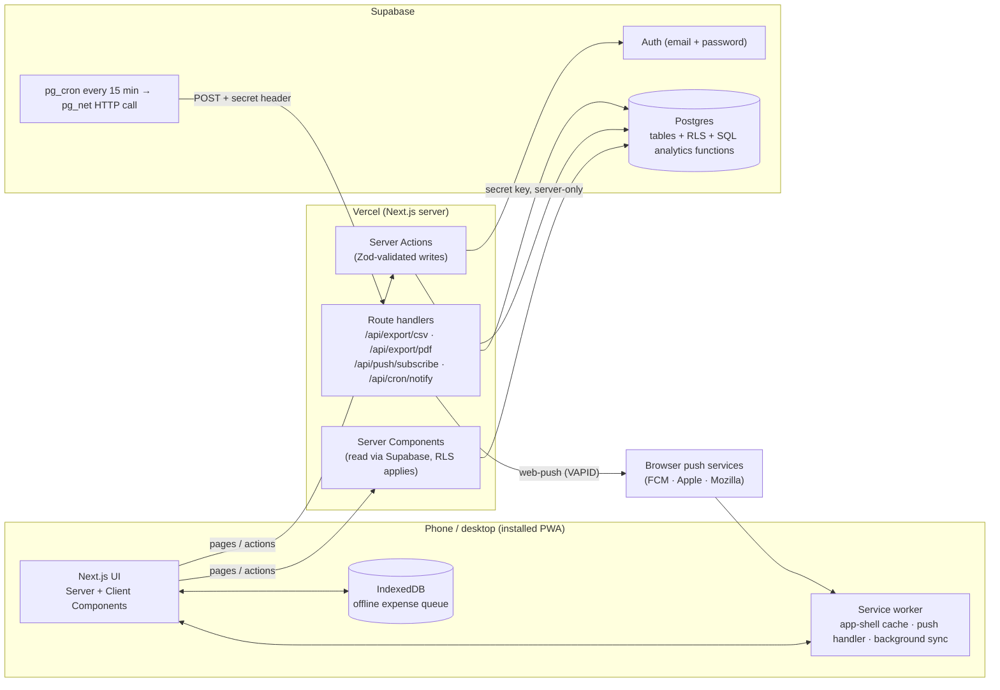
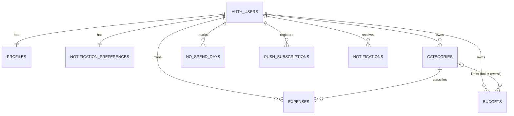

# Phase 1: Product Plan & Architecture

**Status:** Approved · **Date:** 2026-11-19 · **Product name:** SpendWise Auto

> **Decisions since approval (2026-11-20):**
> - **Name:** the product is **SpendWise Auto**. §2's naming research stays as background.
> - **Backend:** **Neon Postgres + Neon Auth** (Managed Better Auth) replace Supabase. Wherever this document says Supabase:
>   - **Data access:** the app queries Postgres with `pg` from Server Actions and Server Components (no PostgREST).
>   - **Access rules:** RLS uses `app.current_user_id()` under the `spendwise_user` role instead of `auth.uid()`.
>   - **Sign-in:** accounts live in Neon's `neon_auth` schema, and each person's profile is created on their first visit.
>   - **Scheduled reminders (§6.4):** need a scheduler other than Supabase `pg_cron`, chosen in Phase 5.
>
>   Setup: [neon-setup.md](neon-setup.md).

This document covers Phase 1 of the master brief: product evaluation, naming and brand, MVP scope, core user journeys, and the system and database architecture. Nothing gets built until this is approved.

Anything marked **[Call]** is a decision I made that you haven't confirmed yet. Overrule any of them.

---

## 1. Product evaluation

**Verdict: worth building, but the hard part is habit, not technology.**

Expense trackers are a crowded category (Spendee, Wallet, Monefy, Money Manager, and many apps literally called SpendWise; see §2). Most of them fail for the same reason: people stop logging after a week or two. Charts and features don't fix that. **Speed of entry and good-natured reminders do.** The product should be designed around one loop:

> Spend money → log it in under 5 seconds → see one useful number → get a gentle nudge only when you forgot.

**What sets this product apart:**

| Differentiator | Why it matters |
|---|---|
| **Sub-5-second quick add** | The main reason people quit. Amount → category → save. Everything else is optional. |
| **Reminders that respect you** | One nudge a day, and only if you haven't logged anything. A "No spending today" button silences it. No shaming copy. |
| **Fair, honest insights** | Compare like with like (Nov 1–19 vs Oct 1–19, not vs all of October). Every insight is computed from your actual records, and nothing shows when there isn't enough data. |
| **Local fit** | Mobile Money is a first-class payment method; GHS formatting is correct; daily totals follow your own timezone. |
| **PWA, works offline** | No app store needed. Expenses entered on a weak connection are queued and synced later, never lost. |

**Risks to design around**

1. **Retention.** Track "days with at least one log" from day one; it's the metric that matters.
2. **iOS push limits.** Web push on iPhone/iPad only works when the app has been *added to the Home Screen* (iOS 16.4+). Onboarding must guide iOS users through installation before offering reminders.
3. **Email deliverability.** Supabase's built-in email service is heavily rate-limited and meant for development only. Production needs a custom SMTP provider (e.g. Resend, Postmark, or Amazon SES) for confirmation and password-reset emails.
4. **Scheduling limits.** Vercel's Hobby-plan cron can only run once a day, which is too coarse for "remind me at 8 pm". This plan uses Supabase `pg_cron` instead (§6.4).

**How we'll know it works (success metrics)**

- Day-7 and day-30 retention.
- Share of active users' days that have at least one log or a "no spending" mark.
- Median time to add an expense (target: under 5 s).
- Reminder → log conversion, and notification opt-out rate (opt-outs signal nagging).

---

## 2. Name and brand

### 2.1 Is "SpendWise" a good name?

| Criterion | Assessment |
|---|---|
| Memorable | Moderately. It's descriptive and clear, but generic. |
| Easy to spell and say | Yes. |
| Trustworthy / finance fit | Yes, it sounds sensible. |
| **Distinctive** | **No.** A quick search (2026-11-19) found at least six App Store apps called *SpendWise* or close variants (SpendWise: Expense Tracker, SpendWise: Budget Tracker, SpendWise: Expense Diary, Spendwise Tracker, MySpendWise, Spend Wise Manager) plus many GitHub projects. |
| **Legal risk** | **Real.** Wise (the money-transfer company) has a public record of opposing "-wise" names in financial services, including a reported opposition against the bill-splitting app Splitwise. |

**Conclusion:** keep it as the internal codename (this repo) but don't launch publicly under it.

### 2.2 Five alternatives

**My assumption [Call]:** your currency list puts the Ghanaian Cedi first, so I'm guessing **Ghana is the launch market**, with other countries later. That assumption drives the recommendation.

| Name | Meaning / feel | Spell & say | What a quick search found (not a legal clearance) |
|---|---|---|---|
| **Pesewa** | Ghana's smallest coin: "every little bit counts". Warm, local, distinctive. | Easy in Ghana; abroad it reads as a friendly coined word (*peh-SEH-wah*). | **No expense app found** under this name. |
| **Tally** | To count things up. Universal, verb-friendly ("tally your day"). | Very easy. | Crowded: at least six "Tally" budget/expense apps, plus the popular Tally forms product. |
| **Kept** | Money that's kept track of. Calm and trustworthy. | Very easy. | Direct clash: *Kept: Budget & Expense Tracker* is an existing iOS app. |
| **Daybook** | A traditional daily accounting ledger. Fits the daily habit. | Easy. | Zoho Daybook (a large company's ledger app) and others. |
| **Sika** | "Money" in Twi. Short and warm in Ghana. | Very easy. | Used by several Ghanaian fintechs (Sika, Naa Sika, Bit Sika, SikaFX) and by the global company Sika AG. |

### 2.3 Recommendation: **Pesewa**

It's the only candidate that is short, meaningful, easy to say, *and* not already a crowded app name. It tells the product's story ("small amounts add up") in one word, and Ghanaian users will understand it instantly.

**If you're targeting a global audience first**, none of the dictionary-word options is clean. In that case keep SpendWise as the codename and run a proper naming round later.

**Before committing, verify (I can't do these for you):**
- Trademark searches in classes 9 and 36: Ghana (Registrar-General's Department), ARIPO, and USPTO/UKIPO if you plan to expand.
- Domain availability (e.g. `pesewa.app`, `getpesewa.com`, `pesewa.com.gh`).
- App Store / Play Store name availability.
- Note that the name of a currency unit can be harder to register as a trademark in its home country. Ask a trademark professional.

**The brand name lives in one config file** (`src/config/brand.ts`), so renaming costs minutes, not a refactor. The code will use "SpendWise" until you decide.

### 2.4 Tagline, personality, and voice

- **Tagline:** *Every pesewa counts.* (Global variant: *Know where your money goes, every day.*)
- **Personality:** a calm, sharp friend who's good with money. Encouraging, honest, and never preachy.
- **Voice rules:** plain words, short sentences, no jargon ("money left", not "remaining allocation"), never shaming.

| Moment | ✅ Say | ❌ Not |
|---|---|---|
| Reminder | "Nothing logged today. Got a minute?" | "You forgot to track your expenses again!" |
| Over budget | "You're GHS 40 over your Food budget this month. Adjust it?" | "Warning: budget violation." |
| Good week | "You spent 12% less than last week." | "Amazing!!! 🎉🎉" |

### 2.5 Colour palette (to be refined in Phase 2)

Contrast ratios are calculated against white.

| Role | Token | Hex | Use |
|---|---|---|---|
| Primary: deep emerald | `--primary` | `#065F46` | Buttons, active nav, brand. ~7.7:1 (AAA) |
| Primary hover / links | `--primary-600` | `#047857` | ~5.5:1 (AA) |
| Secondary: soft mint | `--mint` | `#D1FAE5` | Selected chips, highlights, card tints |
| Mint accent | `--mint-400` | `#6EE7B7` | Chart highlights only (never text on white) |
| Background | `--bg` | `#F7F9F8` | App background (subtle off-white) |
| Surface | `--surface` | `#FFFFFF` | Cards, sheets |
| Text: charcoal | `--fg` | `#1F2937` | Body text |
| Muted text | `--muted-fg` | `#4B5563` | Labels, secondary text (~7.5:1) |
| Positive | `--positive` | `#15803D` | Under budget, spending down |
| Warning: amber | `--warning` | `#B45309` (text) / `#F59E0B` (fill) | ≥ 80% of budget |
| Over budget: red | `--danger` | `#B91C1C` (text) / `#EF4444` (fill) | Over budget, destructive actions |

**Rule:** status is never shown by colour alone; it always comes with a label or icon (for colour-blind users).

### 2.6 Visual identity

- **Typography [Call]:** Inter via `next/font`, with tabular figures (`font-variant-numeric: tabular-nums`) so columns of amounts line up.
- **Logo direction:** a rounded coin with a small check mark inside ("counted"). Wordmark in lowercase, medium weight.
- **App icon:** mint mark on a deep emerald square, legible at 48 px.
- **Style:** generous white space, 12–16 px card radius, soft shadows, one accent colour per screen, Lucide line icons, subtle motion (150–250 ms, and `prefers-reduced-motion` respected).

---

## 3. MVP definition

### 3.1 In the MVP

| Area | Included |
|---|---|
| Accounts | Email sign-up with email confirmation, login, logout, password reset, delete account (with all data) |
| Onboarding | Name, currency, timezone (auto-detected), week start day, optional monthly budget, reminder opt-in |
| Expenses | Quick add (bottom sheet), edit, delete with undo, full history, search (note, category), filters (date range, category, payment method, amount range) |
| Categories | 12 defaults seeded per user; create, rename, recolour, reorder, delete (expenses move to another category) |
| Payment methods | Fixed list: Cash, Mobile Money, Card, Bank Transfer, Other |
| Tracking | Today, this week, and this month: totals, counts, category breakdown, comparison with the previous period, highest day/category |
| Budgets | Overall daily/weekly/monthly budgets plus per-category budgets, progress bars, "money left", daily allowance |
| Dashboard | All 10 items from the brief, plus a quick-add button |
| Reports | Weekly and monthly reports, rule-based insights, CSV and PDF export |
| Notifications | In-app inbox, web push, daily "nothing logged" reminder, optional evening review, weekly/monthly summaries, budget alerts, per-type preferences |
| PWA | Installable, offline app shell, offline read of last-loaded data, **offline expense entry with sync** |
| Localisation | GHS, USD, GBP, EUR, NGN, KES, ZAR, XOF, CAD, AUD, INR, JPY, and others via `Intl.NumberFormat`; English UI |

### 3.2 Not in the MVP (non-goals)

- Bank or Mobile Money account linking, SMS import
- Receipt photos or OCR
- Income tracking, net worth, savings goals
- Multiple currencies per account or currency conversion
- Shared or family budgets
- Recurring or scheduled expenses
- AI chat or AI-generated insights
- Native App Store / Play Store builds (the PWA comes first)
- Dark mode and languages other than English (planned fast-follows; tokens will be ready for dark mode)

### 3.3 Anti-goals (failure even if it "works")

- Notifications that feel like nagging, or more than one reminder a day.
- Any statistic that isn't computed from the user's real records, or comparisons that mislead (e.g. a partial month vs a full month).
- An expense the user entered silently disappearing (offline, a failed save, or a session timeout).
- Any possibility of one user seeing another user's data.
- Adding an expense taking more than about 5 seconds.

### 3.4 Product calls worth checking

- **[Call] "Savings" doesn't count as spending.** Moving money into savings shouldn't eat your budget or show up as "you spent more". Each category gets a "counts as spending" switch; Savings starts switched off and appears as a separate "Set aside" line. Users can change it.
- **[Call] Comparisons are like-for-like.** "This month so far vs the same days last month", and the same for weeks. Labels say so explicitly.
- **[Call] One currency per account.** Changing it relabels amounts and does not convert them; a confirmation dialog explains this.
- **[Call] Budgets are recurring.** A monthly budget applies every month until changed. Budget history isn't stored in the MVP.
- **[Call] One daily reminder time** (in 15-minute steps). If nothing has been logged by then, you get a nudge. If you have logged something and turned on the evening review, you get your day's summary instead. Never both.
- **[Call] Offline: add only.** Adding expenses works offline. Editing and deleting need a connection, which keeps sync conflicts out of the MVP.

---

## 4. Core user journeys

**J1. First run (about 90 s)**
Open the link → "Get started" → email + password → confirm email → onboarding (currency, timezone pre-filled, week start, optional monthly budget) → reminder opt-in (iOS: "Add to Home Screen first", with instructions) → empty dashboard with one clear call to action: *Add your first expense*.

**J2. Quick add (the core loop, under 5 s)**
Tap ➕ (floating button, always visible) → the amount field is focused with a numeric keypad → tap a category chip (sorted by how often you use them) → **Save**. The date defaults to now and the payment method to the last one used. "More" reveals note, date/time, and payment method. A toast confirms: "GHS 25.00 · Transport, Undo". The dashboard numbers update immediately.

**J3. Daily glance (about 3 s)**
Open app → see today's total and count, money left this month plus a daily allowance ("about GHS 45/day for the next 11 days"), and the week/month tiles.

**J4. Fix a mistake**
Transactions → search or filter → tap a row → edit sheet → save, or delete with an undo toast.

**J5. Set a budget**
Budgets → "Monthly budget" → enter an amount → optionally add category budgets → progress bars appear on the dashboard. Alerts at 80% (adjustable) and at 100%.

**J6. Reminder → log**
At 8 pm, if nothing has been logged: a push notification says "Nothing logged today. Got a minute?". Tapping it opens the app with quick add already open. The notification offers a "No spending today" option that marks the day and silences reminders.

**J7. Weekly/monthly review**
Monday morning push: "Last week: GHS 640, 9% less than the week before." → Reports page → charts and insights → Export CSV/PDF.

**J8. Settings**
Profile, currency, timezone, week start, categories, notification preferences (per type and time), export all data, change password, delete account.

---

## 5. Technology stack

Versions checked against the npm registry on 2026-11-19. They'll be pinned exactly when the project is scaffolded.

| Layer | Choice | Current version |
|---|---|---|
| Framework | Next.js (App Router, Server Components, Server Actions) | 16.4.6 |
| UI | React | 19.3.1 |
| Styling | Tailwind CSS | 4.3.5 |
| Components | shadcn/ui (CLI) | 4.23.0 |
| Icons | lucide-react | 1.76.0 |
| Forms & validation | react-hook-form + Zod (shared schemas for client and server) | 7.92.0 / 4.6.7 |
| Charts | Recharts (client-only, loaded on demand) | 3.11.0 |
| Backend | Supabase: Postgres, Auth, RLS, `pg_cron`, `pg_net` | supabase-js 2.119.2, @supabase/ssr 0.12.7 |
| PWA | Serwist (service worker) + `app/manifest.ts` | 9.5.15 |
| Push | `web-push` with VAPID keys | 4.0.0 |
| PDF export | `@react-pdf/renderer` (server-side) | 4.9.0 |
| Tests | Vitest (logic), Supabase SQL tests (RLS), Playwright (end-to-end) | pinned in Phase 3 |
| Hosting | Vercel | |

**To verify in Phase 5:** whether Serwist's Next.js integration works with Next 16's default Turbopack build. Fallback options: build with webpack, or a hand-written service worker following the official Next.js PWA guide.

---

## 6. System architecture



### 6.1 Principles

- **The database is the source of truth for every number.** Totals, breakdowns, comparisons, and budget usage come from SQL functions, never from summing floats in the browser.
- **Reads** use Server Components with a per-request Supabase client acting as the signed-in user, so RLS applies automatically.
- **Writes** go through Server Actions. The same Zod schema validates on the client (instant feedback) and the server (trust boundary). Database `CHECK` constraints are a third line of defence.
- **Fresh numbers:** after each write, `revalidatePath` refreshes affected pages and `useOptimistic` makes quick add feel instant. Per-user data is never put in a shared cache.
- **The secret key** (bypasses RLS) is used in exactly one place: the cron notification route, protected by a `CRON_SECRET` header.

### 6.2 Auth and sessions

- Supabase Auth with email + password and email confirmation required.
- `@supabase/ssr` keeps the session in HTTP-only cookies. Next 16's `proxy.ts` (formerly `middleware.ts`) refreshes the session and redirects signed-out users away from app routes.
- On the server, identity is always taken from `supabase.auth.getUser()` / `getClaims()` (verified), never from an unverified cookie.
- Password reset: email link → `/auth/confirm` (verifies the token) → `/reset-password`.

### 6.3 Time zones (how "today" stays correct)

- `profiles.timezone` stores an IANA zone (e.g. `Africa/Accra`), auto-detected at onboarding with `Intl.DateTimeFormat().resolvedOptions().timeZone` and editable.
- **Each expense stores two things:**
  - `spent_on` (date): the calendar day *the user* says it happened. **All daily, weekly, and monthly bucketing uses this column.**
  - `spent_at` (timestamptz): the exact moment, used for ordering and display.
- "Today" is `(now() AT TIME ZONE profile.timezone)::date`, computed in SQL. Weeks start on the user's chosen day (Monday by default).
- Result: totals never shift because of daylight saving, server location, or travel, and old days never get re-bucketed.

### 6.4 Reminders and notifications

`pg_cron` runs every 15 minutes and calls `POST /api/cron/notify` (via `pg_net`, with the secret in Supabase Vault). The route:

1. Calls `due_notifications(now())`, a SQL function only the server key may execute, which returns users whose local time matches their reminder slot along with what they need:
   - **Daily reminder:** nothing logged today and not marked "no spending".
   - **Evening review** (if enabled): something was logged today.
   - **Weekly summary:** first day of their week, 09:00 local.
   - **Monthly summary:** 1st of the month, 09:00 local.
2. Inserts an in-app notification with a **dedupe key** (e.g. `reminder:2026-11-19`, `weekly:2026-W47`). A unique constraint means a duplicate insert fails, so **a notification can never be sent twice**, even if cron runs twice.
3. Sends web push only for rows that were actually inserted, respecting preferences and a cap of **3 pushes per user per day**.
4. Deletes push subscriptions the push service reports as expired (HTTP 404/410).

**Budget alerts** are triggered when an expense is saved, not by cron. The Server Action checks the affected budgets and creates `budget_warning` (threshold reached, 80% by default) or `budget_exceeded` notifications, de-duplicated per budget and period.

### 6.5 Offline

- **Precache:** app shell, fonts, icons. **Navigations:** network-first, falling back to the last cached page (read-only).
- **Offline add:** the quick-add form writes to an IndexedDB queue with a **client-generated UUID**. The UI shows the expense with a "Waiting to sync" badge.
- **Sync:** the Background Sync API where supported (Chrome/Edge/Android), otherwise whenever the app opens or the `online` event fires. The server inserts with `ON CONFLICT (id) DO NOTHING`, so retries can never create duplicates.

### 6.6 Insights engine (rule-based)

Each insight is a small function that takes SQL aggregates and returns either nothing or `{ text, numbers used }`. **No data, no insight.**

| Insight | Fires when | Example |
|---|---|---|
| Top category | 3 or more expenses this month | "Food & Groceries is your highest spending category this month (GHS 1,240 · 38%)." |
| Category change | Both periods have spending, change ≥ 15%, and the category is ≥ 5% of the week's total | "You spent 15% more on Transportation this week than in the same days last week." |
| Budget usage | A monthly budget exists | "You've used 75% of your monthly budget with 11 days to go." |
| Daily allowance | A monthly budget exists and money is left | "You can spend about GHS 45 a day for the rest of the month." |
| Logging streak | 7 or more days since sign-up | "You logged expenses on 6 of the last 7 days." |

Thresholds live in one config file so they're easy to tune.

---

## 7. Database architecture

### 7.1 Entity overview



### 7.2 Tables

**Enums:** `payment_method` (`cash`, `mobile_money`, `card`, `bank_transfer`, `other`) · `budget_period` (`daily`, `weekly`, `monthly`) · `notification_kind` (`daily_reminder`, `evening_review`, `weekly_summary`, `monthly_summary`, `budget_warning`, `budget_exceeded`)

**`profiles`**: one row per user
| Column | Type | Notes |
|---|---|---|
| `id` | uuid PK → `auth.users` on delete cascade | |
| `display_name` | text | 1–60 chars |
| `currency` | char(3) not null default `'GHS'` | ISO 4217, `^[A-Z]{3}$` |
| `timezone` | text not null default `'Africa/Accra'` | validated against `pg_timezone_names` |
| `week_starts_on` | smallint not null default 1 | 0 = Sunday, 1 = Monday |
| `onboarded_at` | timestamptz | null until onboarding is finished |
| `created_at`, `updated_at` | timestamptz | |

**`categories`**
| Column | Type | Notes |
|---|---|---|
| `id` | uuid PK default `gen_random_uuid()` | |
| `user_id` | uuid not null default `auth.uid()` → `auth.users` cascade | |
| `name` | text not null | 1–40 chars; unique per user (case-insensitive) |
| `icon` | text | Lucide icon name |
| `color` | text | palette token key |
| `sort_order` | int not null default 0 | |
| `counts_as_spending` | boolean not null default true | false for Savings (§3.4) |
| `is_fallback` | boolean not null default false | "Other": can be renamed, not deleted |
| `created_at` | timestamptz | |
| | | `UNIQUE (id, user_id)`, used by the composite foreign keys below |

**`expenses`**
| Column | Type | Notes |
|---|---|---|
| `id` | uuid PK | **may be generated by the client** (offline idempotency) |
| `user_id` | uuid not null default `auth.uid()` → `auth.users` cascade | |
| `amount` | numeric(14,2) not null `CHECK (amount > 0)` | exact decimal, never float |
| `category_id` | uuid not null | **composite FK `(category_id, user_id)` → `categories(id, user_id)`** |
| `payment_method` | payment_method not null default `'cash'` | |
| `note` | text | ≤ 280 chars |
| `spent_on` | date not null | local calendar day (the bucketing key) |
| `spent_at` | timestamptz not null | exact moment |
| `created_at`, `updated_at` | timestamptz | |
| | | Indexes: `(user_id, spent_on DESC)`, `(user_id, category_id, spent_on)` |

> **Why the composite foreign key matters:** foreign-key checks bypass RLS. With a plain FK on `category_id`, a malicious request could attach an expense to *another user's* category ID. `(category_id, user_id)` makes that impossible at the database level. The same pattern is used on `budgets`.

**`budgets`**
| Column | Type | Notes |
|---|---|---|
| `id` | uuid PK | |
| `user_id` | uuid not null default `auth.uid()` | |
| `period` | budget_period not null | |
| `category_id` | uuid null | null = overall budget; composite FK as above |
| `amount` | numeric(14,2) not null `CHECK (amount > 0)` | |
| `alert_at_percent` | smallint not null default 80 | 1–100 |
| `created_at`, `updated_at` | timestamptz | |
| | | `UNIQUE NULLS NOT DISTINCT (user_id, period, category_id)` |

**`no_spend_days`**: `(user_id, day date)` primary key. Silences the reminder and counts toward the logging streak.

**`notification_preferences`**: one row per user
| Column | Default |
|---|---|
| `daily_reminder_enabled` | true |
| `reminder_time` | `20:00` (15-minute steps) |
| `evening_review_enabled` | false |
| `weekly_summary_enabled` | true |
| `monthly_summary_enabled` | true |
| `budget_alerts_enabled` | true |

**`push_subscriptions`**: `id`, `user_id`, `endpoint` (unique), `p256dh`, `auth`, `user_agent`, `created_at`, `last_success_at`, `failure_count`. One row per device.

**`notifications`** (in-app inbox): `id`, `user_id`, `kind`, `title`, `body`, `data` jsonb (deep link), `dedupe_key`, `read_at`, `created_at`. `UNIQUE (user_id, dedupe_key)`.

### 7.3 Row Level Security

RLS is enabled on **every** table. The policy pattern, using `(select auth.uid())` so Postgres evaluates it once per query rather than once per row:

```sql
alter table public.expenses enable row level security;

create policy "Users read own expenses"   on public.expenses for select to authenticated
  using ((select auth.uid()) = user_id);
create policy "Users insert own expenses" on public.expenses for insert to authenticated
  with check ((select auth.uid()) = user_id);
create policy "Users update own expenses" on public.expenses for update to authenticated
  using ((select auth.uid()) = user_id) with check ((select auth.uid()) = user_id);
create policy "Users delete own expenses" on public.expenses for delete to authenticated
  using ((select auth.uid()) = user_id);
```

- `notifications`: users may **read and mark as read** only. Inserts come from the server (secret key) or from `security definer` functions that check the caller.
- `anon` role: no access to any table.
- Analytics SQL functions are `security invoker`, so RLS still applies inside them.
- RLS is **tested**: SQL tests that sign in as user A and assert user B's rows are invisible and unwritable.

### 7.4 Database functions and triggers

| Function | Purpose |
|---|---|
| `handle_new_user()` trigger on `auth.users` | Creates the profile and notification preferences, and seeds the 12 default categories |
| `local_today()` | The current date in the caller's timezone |
| `period_bounds(kind, ref_date)` | Start/end dates for a day, week (respecting `week_starts_on`), or month |
| `period_summary(from, to)` | Total, count, and per-category breakdown (spending categories only) |
| `daily_series(from, to)` | Totals per day with zero-filled gaps (`generate_series`) for charts |
| `monthly_series(months)` | Monthly totals for trend charts |
| `budget_status(ref_date)` | Every budget with spent, remaining, percentage, and state (ok / warning / over) |
| `due_notifications(at)` | Server-only; drives cron reminders and summaries |

**Default categories (seeded per user):** Food & Groceries · Transportation · Rent & Housing · Utilities & Bills · Shopping · Healthcare · Education · Entertainment · Family & Gifts · Business · Savings (*doesn't count as spending*) · Other (*fallback*).

**Deleting a category:** the user picks a category to move its expenses to (Other by default). This happens in one transaction, so no expense is ever orphaned.

---

## 8. Security and performance checklist

- [ ] Zod validation in every Server Action and route handler; DB `CHECK` constraints mirror the rules.
- [ ] RLS on all tables, composite FKs for cross-table ownership, and RLS tests in CI.
- [ ] Secret key and VAPID private key are server-only (no `NEXT_PUBLIC_` prefix) and never imported into client code (enforced with the `server-only` package).
- [ ] Cron endpoint requires the `CRON_SECRET` header and rejects everything else.
- [ ] Security headers: CSP, `X-Content-Type-Options`, `Referrer-Policy`, `Permissions-Policy`.
- [ ] No personal or financial data in URLs, logs, or analytics.
- [ ] Account deletion removes all user data (cascades from `auth.users`).
- [ ] Performance: Server Components for first paint, SQL-side aggregation, indexes on `(user_id, spent_on)`, Recharts loaded only where charts appear, `next/font`, SVG icons, no client fetch waterfalls. Target: Lighthouse mobile ≥ 90 for performance and accessibility.

---

## 9. Project structure (planned)

```
spendwise/
├─ src/
│  ├─ app/
│  │  ├─ (auth)/            login · signup · forgot-password · reset-password
│  │  ├─ auth/confirm/      route.ts (email link verification)
│  │  ├─ onboarding/
│  │  ├─ (app)/             layout with bottom nav (mobile) / sidebar (desktop)
│  │  │  ├─ page.tsx        dashboard
│  │  │  ├─ transactions/
│  │  │  ├─ budgets/
│  │  │  ├─ reports/
│  │  │  └─ settings/       profile · categories · notifications · account
│  │  ├─ api/               cron/notify · push/subscribe · export/csv · export/pdf
│  │  ├─ manifest.ts
│  │  └─ sw.ts              service worker source
│  ├─ components/           ui/ (shadcn) · expenses/ · budgets/ · charts/ · layout/
│  ├─ config/               brand.ts · currencies.ts · insights.ts
│  ├─ lib/                  supabase/{client,server,admin}.ts · money.ts · dates.ts · insights/ · offline-queue.ts
│  ├─ schemas/              Zod schemas shared by forms and actions
│  └─ server/               actions/ · queries/ · notifications/
├─ supabase/
│  ├─ migrations/           versioned SQL (schema, RLS, functions, cron)
│  ├─ tests/                RLS + function tests
│  └─ seed.sql              clearly labelled DEMO data for local development only
├─ tests/e2e/               Playwright
├─ docs/
└─ .env.example
```

**Environment variables (`.env.example`):**

```
NEXT_PUBLIC_SITE_URL=http://localhost:3000
NEXT_PUBLIC_SUPABASE_URL=
NEXT_PUBLIC_SUPABASE_PUBLISHABLE_KEY=
SUPABASE_SECRET_KEY=            # server only
NEXT_PUBLIC_VAPID_PUBLIC_KEY=
VAPID_PRIVATE_KEY=              # server only
VAPID_SUBJECT=mailto:you@example.com
CRON_SECRET=                    # server only, long random string
```

---

## 10. Implemented vs needs external setup

| I can build and test locally | Needs your accounts / configuration |
|---|---|
| All app code, migrations, RLS, SQL functions, tests | Supabase project (URL and keys) |
| Local Supabase via the Supabase CLI (requires Docker) | Custom SMTP provider for auth emails |
| VAPID key generation | Auth redirect URLs in the Supabase dashboard |
| Service worker, manifest, offline queue | `pg_cron`/`pg_net` enabled and the cron job's secret stored in Vault on the hosted project |
| CSV/PDF export | Vercel project, environment variables, custom domain |
| Push sending code (testable on localhost in Chrome) | Real-device push testing (especially iOS with the app installed) |
| | Trademark and domain checks for the final name |

---

## 11. Roadmap

I'll keep your six phases, with one adjustment **[Call]**: Phases 3–5 are built **feature by feature** (database → server → UI for each feature) rather than strictly layer by layer, so you have a working app to try at the end of each step instead of only at the end. Tests are written alongside each feature (calculation logic test-first), not saved for Phase 6.

| Phase | Deliverable you'll review |
|---|---|
| **2. UI/UX** | Design tokens; clickable mockups (mobile and desktop) for onboarding, dashboard, quick add, transactions, budgets, reports, settings/notifications |
| **3. Database & backend** | Next.js scaffold, Supabase migrations (schema, RLS, triggers, analytics functions), auth flows, expense CRUD, calculation tests, Supabase setup guide |
| **4. Frontend** | Working dashboard, quick add, transactions, budgets, reports, insights, exports, settings |
| **5. PWA & notifications** | Installable app, offline queue, push subscription, cron reminders, summaries, budget alerts, preferences |
| **6. Testing & deployment** | Playwright journeys J1–J8, RLS tests, accessibility/Lighthouse pass, offline and push test notes, Vercel deployment guide |

---

## 12. Open decisions

| # | Decision | My default if you don't say otherwise |
|---|---|---|
| 1 | Final brand name | **Pesewa** (pending your trademark/domain checks); code uses "SpendWise" until confirmed |
| 2 | Launch market | **Ghana first** (GHS default, `Africa/Accra`, Mobile Money prominent) |
| 3 | Do you already have Supabase and Vercel accounts? | Build against local Supabase; you connect the hosted project before Phase 5 |
| 4 | Any §3.4 product call you disagree with | As written |
